# 🐀 Rat 3D Reconstruction & First-Person View Toolkit

Markerless, multi-camera 3D reconstruction for two freely moving rats: from
raw checkerboard footage to a calibrated six-camera rig, textured 3D rats,
tracked heads and a reconstructed **rat's-eye view**. Every stage is a small
browser GUI backed by a local Python server, and the stages only talk to each
other through plain files (JSON, PNG, OBJ, CSV).

This is the 3D part of my master's thesis at the Institute of Neuroinformatics
(UZH / ETH Zurich). The segmentation masks it starts from and the behaviour
classifier are in the companion repository
[rat-social-behaviour-classification](https://github.com/Tschedii/rat-social-behaviour-classification).

<p align="left">
  
  
  
  
  
  
</p>

<table>
  <tr>
    <td width="33%">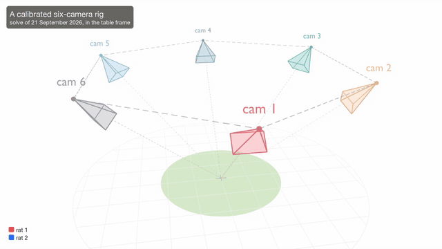</td>
    <td width="33%">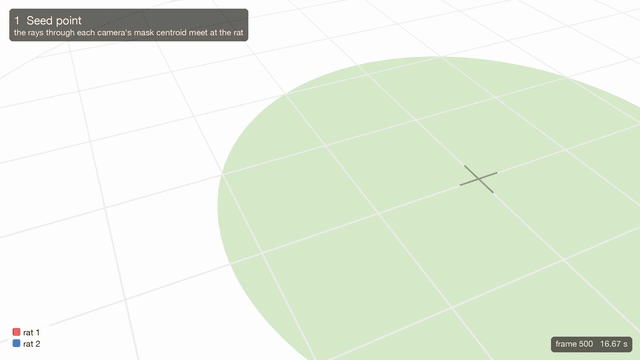</td>
    <td width="33%">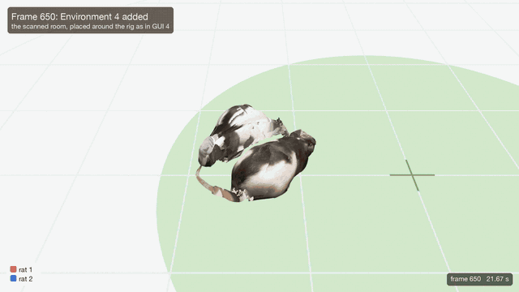</td>
  </tr>
  <tr>
    <td align="center"><b>1</b> calibrated six-camera rig</td>
    <td align="center"><b>2</b> seed point, voxel carving, surface, template fit, fur colours</td>
    <td align="center"><b>3</b> scanned room, field of view, rat 1's first-person view</td>
  </tr>
</table>

▶️ **Full video (55 s, MP4, 4 MB):** [download `rig_to_first_person.mp4`](https://raw.githubusercontent.com/Tschedii/rat-3d-reconstruction-1pov/master/docs/media/rig_to_first_person.mp4),
the whole pipeline on the Day 7 session (rats rPEG007 and rPEG008), rendered
with [`video_rendering/`](video_rendering).

---

## What this is

Six synchronised cameras film two rats in a round arena, each rat with a
head-mounted IMU. This toolkit turns the recordings into:

1. a **rig calibration** (intrinsics, extrinsics, bundle adjustment, a table-aligned world frame),
2. a **3D mesh of each rat per frame** (visual hull, completed by fitting a rat template),
3. **eye positions and the field of view** of each rat,
4. a **placed 3D scene** (rig, scanned room, both rats) and renders through a rat's eyes,
5. the **head pose of both rats over time**, from the IMUs and from the masks alone,
6. **videos** that put all of it together.

## What's new (October 2026)

- Stages renumbered in the order they are run: GUI 3 is now eye marking and GUI 4 scene placement.
- **GUI 2:** model-based completion. A rat template (embedded deformation graph, PyTorch) is fitted to the
  silhouettes and the hull, so parts that only a few cameras see (the head) are no longer carved away. Also
  a relaxed head zone for carving, a procedural template generator, a converter for external rat models and
  a per-camera coverage diagnostic.
- **GUI 5.1:** IMU head pose for **two rats**: body position triangulated from the masks of all cameras,
  orientation from each rat's head IMU, heading re-anchored on the walking direction. Exports a top-down
  video and a rotating-skull video per rat.
- **GUI 5.2:** head tracking **from the masks alone** (no IMU) for both rats, with a Viterbi tracker over
  every 3D head candidate that at least two cameras agree on.
- **GUI 5.3:** three-panel video (camera view, skulls, 3D head paths) for one or two rats.
- [`video_rendering/`](video_rendering): Blender pipeline for the rig-to-first-person video above.
- [`beast3d_export/`](beast3d_export): converter from a segmented rig session to a
  [BEAST3D](https://github.com/paninski-lab/beast) training set, with calibration and camera-sync checks.

## Pipeline

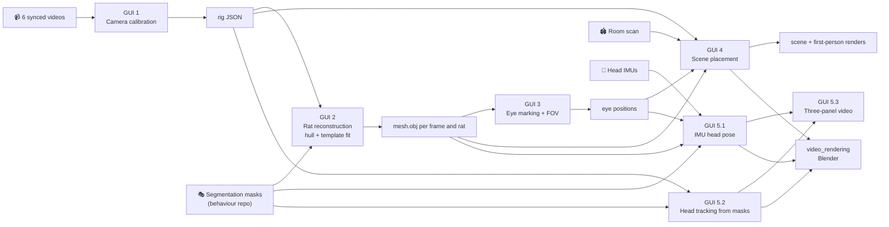

| Stage | Folder | Port | Input | Output | Core method |
|---|---|---|---|---|---|
| 1 | [`gui_1_camera_calibration`](gui_1_camera_calibration) | 8971 | checkerboard videos | rig JSON + rig plots | OpenCV intrinsics, averaged extrinsics, robust bundle adjustment |
| 2 | [`gui_2_rat_reconstruction`](gui_2_rat_reconstruction) | 8972 | rig JSON + masks | `mesh.obj` per frame and rat | visual hull, Taubin smoothing, template fit, texture atlas |
| 3 | [`gui_3_eye_marking`](gui_3_eye_marking) | 8974 | meshes | eye positions + head basis | 3D marking on the mesh |
| 4 | [`gui_4_scene_placement`](gui_4_scene_placement) | 8973 | rig JSON + meshes + room scan + eyes | placed scene, first-person renders | three.js, table-aligned frame |
| 5.1 | [`gui_5.1_quaternion_placement`](gui_5.1_quaternion_placement) | 8975 | rig, masks, IMU CSVs, anchor mesh + eyes | head pose per frame, top-down and skull videos | triangulated body + IMU orientation, heading re-anchoring |
| 5.2 | [`gui_5.2_head_tracking`](gui_5.2_head_tracking) | 8978 | rig + masks | 3D head, body and heading per frame | head from mask shape, multi-view triangulation, Viterbi tracking |
| 5.3 | [`gui_5.3_three_panel_video`](gui_5.3_three_panel_video) | 8981 | camera video, 5.1 and 5.2 exports | three-panel MP4 | matplotlib + ffmpeg |

## Repository structure

```
rat-3d-reconstruction-1pov/
├── gui_1_camera_calibration/      # Stage 1: checkerboard calibration + bundle adjustment
├── gui_2_rat_reconstruction/      # Stage 2: visual hull + template completion
├── gui_3_eye_marking/             # Stage 3: eye marking + field of view
├── gui_4_scene_placement/         # Stage 4: three.js scene, room scan, first-person renders
├── gui_5.1_quaternion_placement/  # Stage 5.1: IMU head pose, two rats
├── gui_5.2_head_tracking/         # Stage 5.2: head tracking from the masks
├── gui_5.3_three_panel_video/     # Stage 5.3: three-panel video
├── video_rendering/               # Blender pipeline for the rig-to-first-person video
├── beast3d_export/                # rig session -> BEAST3D dataset, calibration + sync checks
├── data/                          # shared workspace between the GUIs (see data/README.md)
├── docs/media/                    # images and videos used in this README
├── requirements.txt
└── LICENSE
```

## Requirements

- Python 3.9+ with `numpy`, `opencv-python`, `scipy`, `scikit-image`, `matplotlib`, `Pillow`
  (`pip install -r requirements.txt`); `torch` (CPU is enough) for GUI 2's template completion
- Node.js ≥ 18 only to rebuild a three.js frontend (`bundle.js` is committed for GUIs 4, 5.1 and 5.2)
- ffmpeg for the video exports, Blender 5.1 for `video_rendering/`
- A modern browser

## Quickstart

```bash
pip install -r requirements.txt
python gui_1_camera_calibration/server.py          # http://127.0.0.1:8971
python gui_2_rat_reconstruction/server.py          # http://127.0.0.1:8972
python gui_3_eye_marking/eye_marker_server.py      # http://127.0.0.1:8974
python gui_4_scene_placement/env_marker_server.py  # http://127.0.0.1:8973
python gui_5.1_quaternion_placement/server.py      # http://127.0.0.1:8975
python gui_5.2_head_tracking/server.py             # http://127.0.0.1:8978
python gui_5.3_three_panel_video/server.py         # http://127.0.0.1:8981
```

Run the stages in order the first time; afterwards each one can be re-run on
its own against the files already on disk. Every GUI is a static
`index.html` plus a `ThreadingHTTPServer` with a small JSON API; long runs
happen in a background thread and the page polls their progress.

---

## Stage 1: Camera calibration

Intrinsics per camera from a board swept over each image, then extrinsics from
a synchronous recording: per-frame poses are averaged, refined jointly by a
robust bundle adjustment (Huber loss) and cleaned by an outlier pass. The rig
is finally expressed in a **table frame** (z up, origin where the optical axes
meet) that every later stage shares. Details in the
[GUI 1 README](gui_1_camera_calibration/README.md).

<p align="center">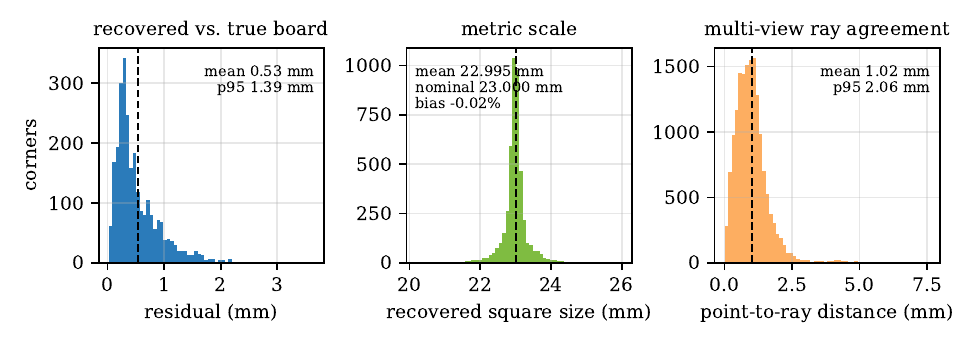</p>

Checked against the known board geometry, the calibrated rig places the board
corners with a mean residual of 0.53 mm (95th percentile 1.39 mm), measures the
nominal 23 mm squares as 22.995 mm on average, and rays from different cameras
meet within 1.02 mm on average.

<details>
<summary>Per-camera extrinsic quality (scatter over frames, reprojection error before and after bundle adjustment)</summary>
<p align="center">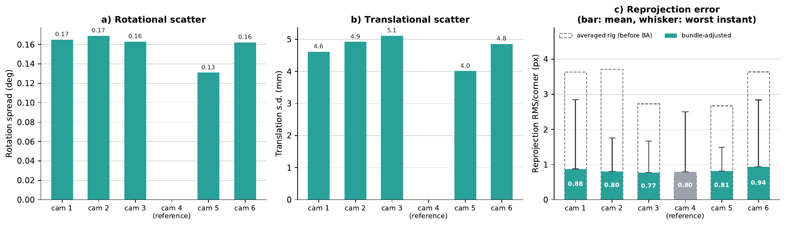</p>
</details>

## Stage 2: Rat mesh reconstruction

For every frame and rat, the centroid is triangulated from the masks (no seed
point needed), a 2 mm voxel grid is carved by the six silhouettes, and marching
cubes plus Taubin smoothing give the surface. The **visual hull** loses parts
that only a minority of cameras see (mostly the head), so a **rat template is
fitted** to the silhouettes and the hull: where the cameras agree it follows the
data, where they do not the template's anatomy fills in. The mesh is textured
from the cameras (baked atlas or vertex colour). Details in the
[GUI 2 README](gui_2_rat_reconstruction/README.md).

<p align="center">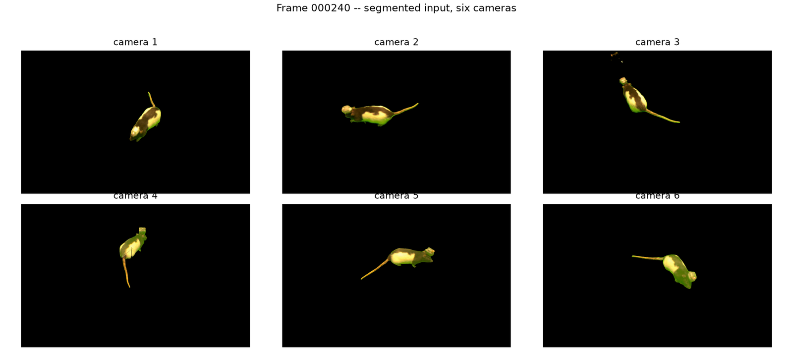</p>
<p align="center">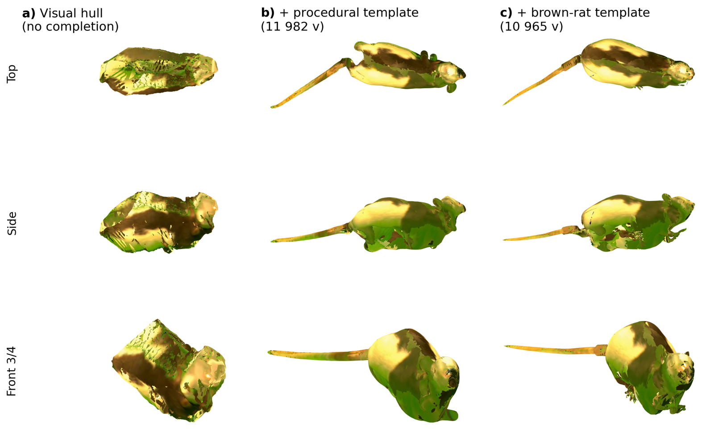</p>

*Frame 240: the six segmented views (top) and the reconstruction (bottom): (a)
visual hull, (b) fit of the procedural template, (c) fit of the brown-rat
template used in the thesis.*

## Stage 3: Eye marking and field of view

Both eyes are marked once on the textured 3D mesh. They define a head basis
(forward, right, up) and, with a 200° cone per eye, the rat's field of view:
62° binocular in front, a small blind sector behind. Details in the
[GUI 3 README](gui_3_eye_marking/README.md).

<p align="center">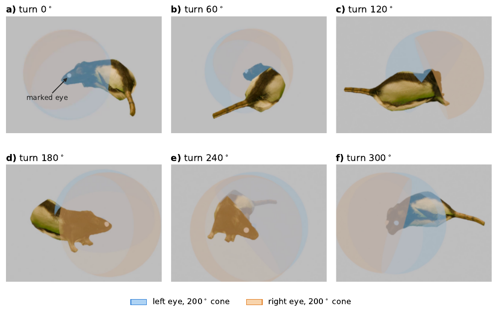</p>

<details>
<summary>Head-centred coverage of the two eyes</summary>
<p align="center">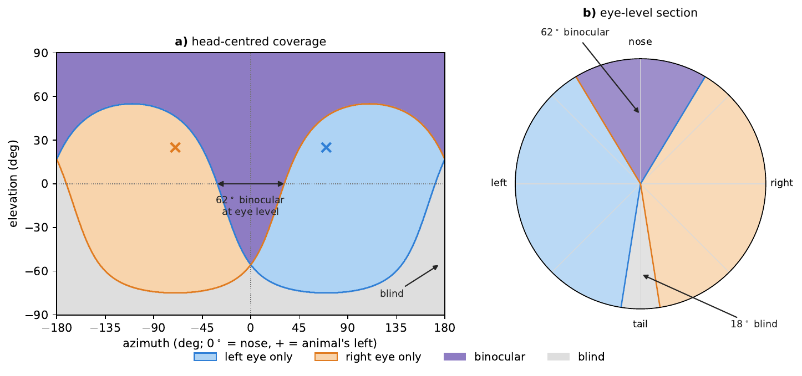</p>
</details>

## Stage 4: Scene placement

The rig, the scanned room and both reconstructed rats are placed in one
three.js scene, in the table frame. The rats keep their true positions relative
to each other, and the scene can be rendered **through either eye of either
rat**. Details in the [GUI 4 README](gui_4_scene_placement/README.md).

<p align="center">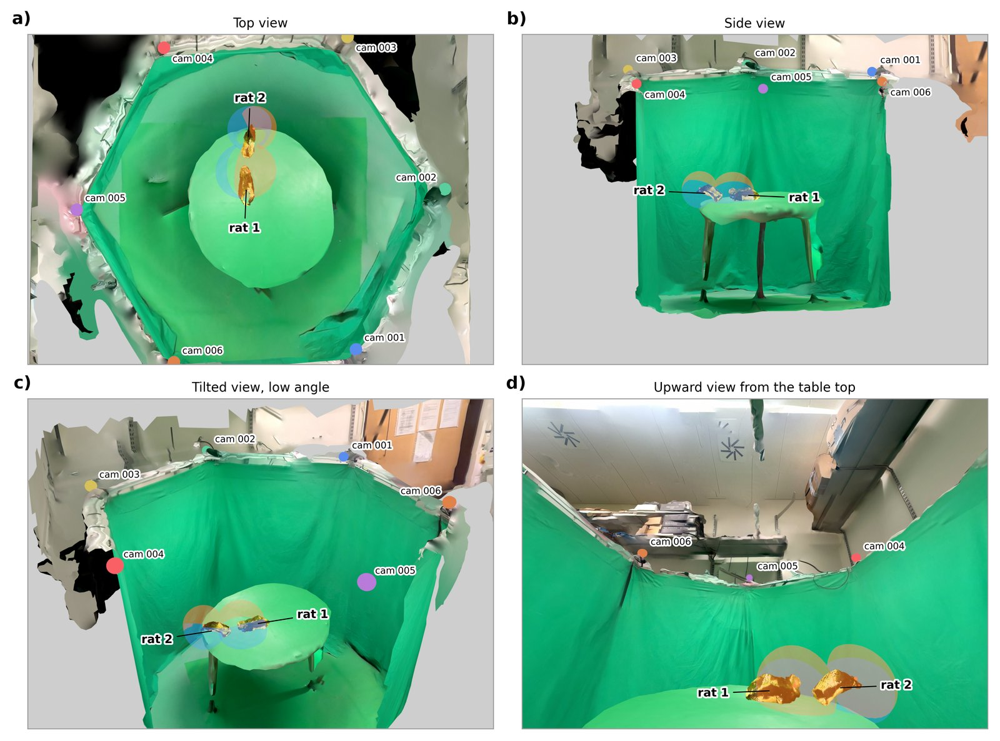</p>
<p align="center">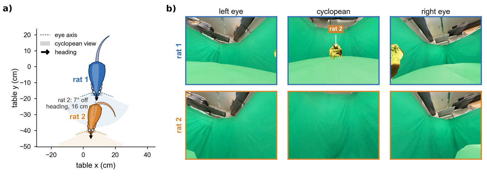</p>

<details>
<summary>Both rats at frame 241 in the rig (left) and on the table (right)</summary>
<p align="center">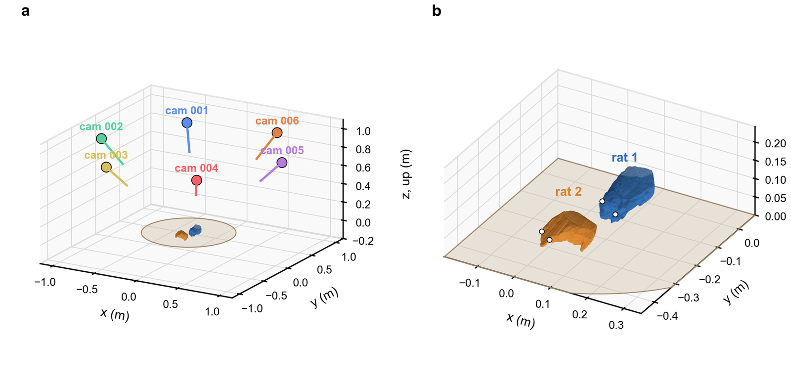</p>
</details>

## Stage 5.1: IMU head pose (two rats)

Each rat's head IMU gives a gravity-referenced orientation whose heading
drifts. The body position is triangulated from the masks of all cameras, the
body axis is fused across views, and every 100 frames the IMU heading is
re-anchored to that body axis (its nose/tail sign taken from the direction of
travel). One anchor frame per rat (its GUI 2 mesh
and marked eyes) fixes the head point. On Day 7 the IMU files match their rats
clearly: heading-vs-walking correlation 0.84 and 0.77, against 0.54 and 0.48
for the swapped pairing. Details in the
[GUI 5.1 README](gui_5.1_quaternion_placement/README.md).

<p align="center">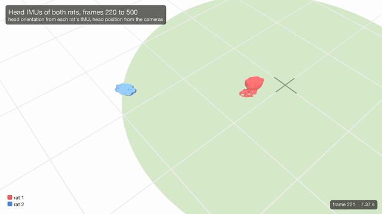</p>

## Stage 5.2: Head tracking from the masks

Without any IMU: per camera and frame the tail is removed from the mask by an
opening, the head is the body point farthest from the tail base, and heads
from different cameras are triangulated. A Viterbi tracker chooses, frame by
frame, among every 3D head that at least two cameras agree on, penalising
contradicting cameras and large jumps. For rat 2 over frames 220 to 1400 this
removed every jump above 5 cm (23 before) and gives a head in every frame.
Details in the [GUI 5.2 README](gui_5.2_head_tracking/README.md).

<p align="center">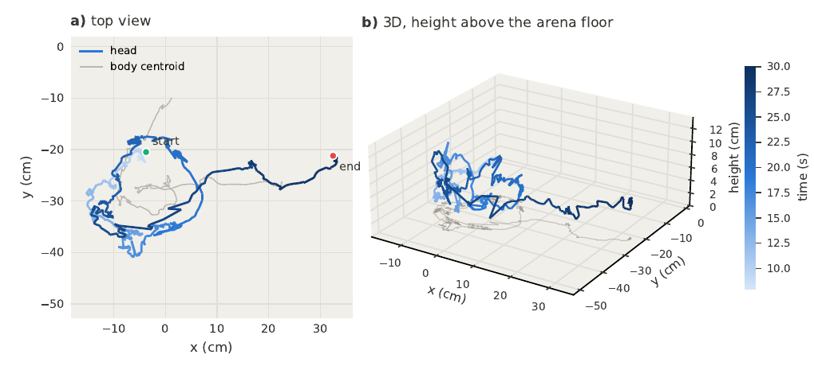</p>

## Stage 5.3: Three-panel video

Camera view with both rats tinted from their masks and their recent head
paths, the two IMU skulls, and both 3D head paths, all in sync.

<p align="center">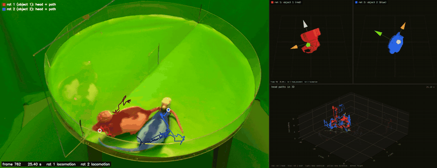</p>

▶️ **Full video (39 s, MP4, 3 MB):** [download `head_tracking_two_rats.mp4`](https://raw.githubusercontent.com/Tschedii/rat-3d-reconstruction-1pov/master/docs/media/head_tracking_two_rats.mp4)

<details>
<summary>Single frames: the cap and skull pose against the camera view</summary>
<p align="center">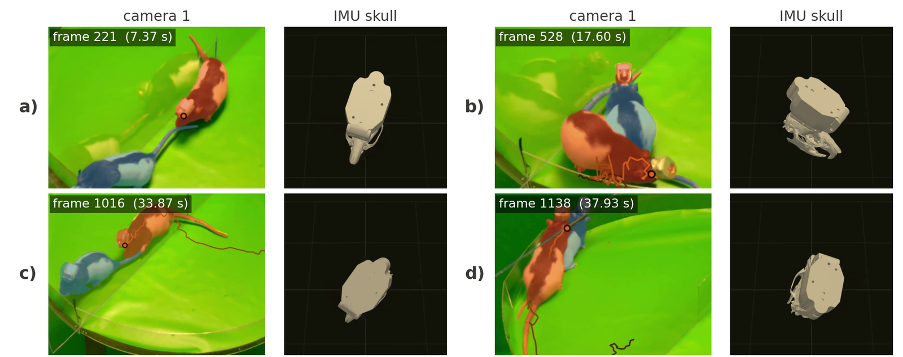</p>
</details>

## Video rendering (Blender)

[`video_rendering/`](video_rendering) renders the rig-to-first-person video:
rig orbit, both IMU skulls with their paths (frames 220 to 500), GUI 2's
reconstruction at frame 500 step by step, both rats moving with refitted
upright templates, the scanned room, rat 1's field of view and its
gimbal-stabilised first-person view (frames 750 to 1000). See the
[folder README](video_rendering/README.md).

## BEAST3D export

[`beast3d_export/`](beast3d_export) turns a segmented rig session into a
[BEAST3D](https://github.com/paninski-lab/beast) dataset and checks the
calibration and camera sync on the way. On Day 7 it showed that the
calibration fits (leave-one-out hull recall 0.87 to 0.90) and that three
cameras drift 3 to 7 frames behind after about frame 6000, which matters for
every frame-by-frame multi-view step. See the [folder README](beast3d_export/README.md).

---

## Data conventions

All shared inputs and outputs and their folder layouts are documented in
[`data/README.md`](data/README.md). Videos, masks, calibrations, meshes and
exports are generated locally and stay out of git.

**Not in this repository:**
- recordings, masks, meshes, IMU files and exports (data);
- `gui_5.1_quaternion_placement/assets/cap_head.stl`, the scan of the head cap
  (128 MB, above GitHub's file limit). GUI 5.1 draws plain axes without it;
- `gui_2_rat_reconstruction/templates/rat_brown.obj`, made from a third-party
  rat model; GUI 2 falls back to the procedural `rat_template.obj`.

## Design notes

- **No manual seed points.** GUI 2 triangulates each rat's mask centroids per frame.
- **Rig-relative, not room-relative.** The table frame comes from the calibration itself (mean viewing
  direction, least-squares meeting point of the optical axes), so any calibrated rig opens correctly oriented.
- **A rotation, not a reflection.** The remap from the calibration frame to three.js's y-up frame has
  determinant +1; an axis swap can look right for positions while flipping handedness.
- **Identity comes from the masks.** Rat n is object n in the segmentation everywhere (red = rat 1,
  blue = rat 2), so tracking, IMU assignment and rendering never have to re-identify the animals.

## License

[MIT](LICENSE)
